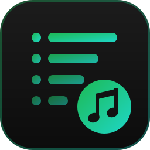
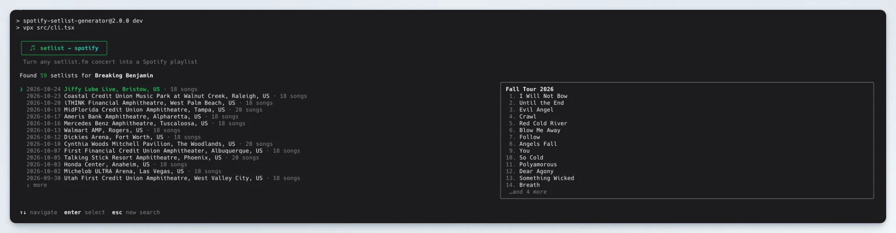
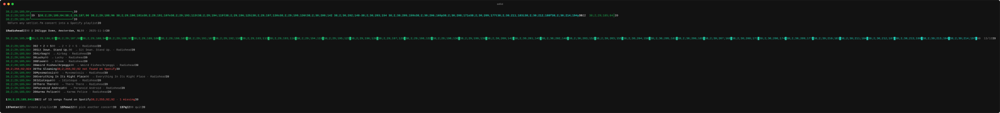
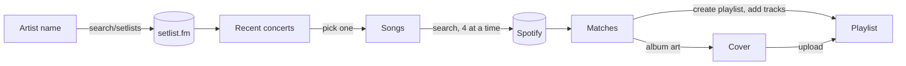

<div align="center">
  

  <h1>spotify-setlist-generator</h1>

  <p><strong>Turn any <a href="https://www.setlist.fm">setlist.fm</a> concert into a Spotify playlist, from a terminal UI.</strong></p>

  <p>
    
    
    
    <a href="LICENSE"></a>
  </p>
</div>

<p align="center">
  
</p>

Just been to a great show and want to relive it? Search the artist, pick the concert from their
recent setlists, watch every song get matched on Spotify and create the playlist, complete with a
poster-style cover, in a single keypress.

## Contents

- [Features](#features)
- [Requirements](#requirements)
- [Getting started](#getting-started)
- [Usage](#usage)
- [Configuration](#configuration)
- [How it works](#how-it-works)
- [Troubleshooting](#troubleshooting)
- [Development](#development)
- [License](#license)

## Features

- **Artist search** across the last 60 setlists on setlist.fm, skipping future shows and empty
  setlists.
- **Live preview** of the highlighted setlist (tour name and songs) next to the concert list, on
  terminals that are at least 100 columns wide.
- **Song matching** on Spotify, four songs at a time, with a progress bar and a ✓ / ✗ per song.
  Covers are searched under the original artist, so a Joy Division cover played by your band ends
  up as the Joy Division recording.
- **Review before creating**: see exactly which songs were found and which were not, then create
  the playlist or go back and pick another concert.
- **Generated cover art**: a concert-poster style cover with the artist, venue and date over a
  blurred collage of the albums played most that night.
- **Browser login with PKCE**: no client secret to manage, and the token is cached and refreshed
  automatically.

<p align="center">
  
</p>

## Requirements

- [Node.js](https://nodejs.org) 24 or newer
- A Spotify account
- A Spotify app (free, for the client id)
- A setlist.fm API key (free, for non-commercial use)

## Getting started

### 1. Create a Spotify app

1. Open the [Spotify developer dashboard](https://developer.spotify.com/dashboard) and click
   **Create app**.
2. Add `http://127.0.0.1:8888/callback` as a **Redirect URI**. Spotify does not accept `localhost`,
   it has to be `127.0.0.1`.
3. Tick **Web API** under the APIs used and save.
4. Copy the **Client ID**. You don't need the client secret, login uses the
   [Authorization Code with PKCE](https://developer.spotify.com/documentation/web-api/tutorials/code-pkce-flow)
   flow.

> [!NOTE]
> Apps in development mode can only be used by Spotify accounts you add under **User Management**
> in the app settings. Your own account works out of the box.

### 2. Get a setlist.fm API key

Apply for one at [setlist.fm/settings/apps](https://www.setlist.fm/settings/apps) (you need a
setlist.fm account). The key looks like `xxxxxxxx-xxxx-xxxx-xxxx-xxxxxxxxxxxx`.

### 3. Install and run

```bash
git clone https://github.com/larsvanbraam/spotify-setlist-generator.git
cd spotify-setlist-generator
cp .env.example .env   # fill in your Spotify client id and setlist.fm API key
npm install
npm run dev
```

The first run opens your browser to log in to Spotify. If it doesn't, the login URL is shown in the
terminal.

### Install as a global command

```bash
npm run build && npm link
```

After that you can run `setlist` from any directory. It reads `.env` from the directory you run it
in, so either run it from the project folder or export the variables in your shell profile:

```bash
export SPOTIFY_CLIENT_ID=your-spotify-client-id
export SETLIST_API_KEY=your-setlist-fm-api-key
```

## Usage

1. **Search**: type the name of the artist you saw and press <kbd>enter</kbd>.
2. **Pick a concert**: browse the most recent setlists, newest first. The panel on the right
   previews the songs of the highlighted concert.
3. **Match**: every song is looked up on Spotify. Songs that can't be found are marked with a ✗
   and left out of the playlist.
4. **Create**: press <kbd>enter</kbd> to create the playlist. When you quit, the links to all
   playlists created in the session are printed to the terminal.

### Keyboard shortcuts

| Screen       | Key                                                   | Action                     |
| ------------ | ----------------------------------------------------- | -------------------------- |
| Search       | <kbd>enter</kbd>                                      | Search setlist.fm          |
|              | <kbd>ctrl</kbd>+<kbd>u</kbd>                          | Clear the input            |
| Concert list | <kbd>↑</kbd> <kbd>↓</kbd> / <kbd>k</kbd> <kbd>j</kbd> | Move the selection         |
|              | <kbd>page up</kbd> <kbd>page down</kbd>               | Jump a page                |
|              | <kbd>enter</kbd>                                      | Match this concert's songs |
|              | <kbd>esc</kbd>                                        | Back to search             |
| Review       | <kbd>enter</kbd>                                      | Create the playlist        |
|              | <kbd>esc</kbd>                                        | Pick another concert       |
| Done         | <kbd>n</kbd>                                          | Make another playlist      |
| Review, done | <kbd>q</kbd>                                          | Quit                       |
| Anywhere     | <kbd>ctrl</kbd>+<kbd>c</kbd>                          | Quit                       |

### The playlist

| Field       | Value                                                                           |
| ----------- | ------------------------------------------------------------------------------- |
| Name        | `<artist> - <venue> - <yyyy-mm-dd>`, e.g. `Radiohead - Ziggo Dome - 2025-11-14` |
| Description | `Setlist of <artist> at <venue, city, country>.` and the setlist.fm link        |
| Visibility  | Public                                                                          |
| Tracks      | All sets and encores in setlist order, minus songs not on Spotify               |
| Cover       | Generated poster with blurred album art from the setlist                        |

## Configuration

All configuration is done through environment variables, read from `.env` in the current
directory (see [`.env.example`](.env.example)) or from the environment itself.

| Variable               | Required | Default                          | Description                                                                              |
| ---------------------- | -------- | -------------------------------- | ---------------------------------------------------------------------------------------- |
| `SPOTIFY_CLIENT_ID`    | yes      |                                  | Client ID of your Spotify app.                                                           |
| `SETLIST_API_KEY`      | yes      |                                  | Your setlist.fm API key.                                                                 |
| `SPOTIFY_REDIRECT_URI` | no       | `http://127.0.0.1:8888/callback` | Must exactly match a redirect URI of your Spotify app. Change the port if 8888 is taken. |
| `XDG_CONFIG_HOME`      | no       | `~/.config`                      | Where the Spotify token is stored.                                                       |

### Spotify permissions

The app asks for the following scopes, and nothing else:

| Scope                     | Used for                  |
| ------------------------- | ------------------------- |
| `playlist-modify-public`  | Creating the playlist     |
| `playlist-modify-private` | Adding tracks to it       |
| `ugc-image-upload`        | Uploading the cover image |

The token is stored in `~/.config/spotify-setlist-generator/token.json` (readable only by you).
Delete that file to log out, or to log in with another account.

## How it works



- **setlist.fm**: up to three pages (60 setlists) are fetched with a pause between requests to stay
  within the API's rate limit. All sets and encores are flattened into one list of songs, and
  unnamed songs (setlist.fm's placeholders) are skipped.
- **Matching**: each song is searched with `track:<song> artist:<artist>` and the first result is
  used. For covers the original artist is searched instead. Spotify rate limits (`429`) are
  retried after the `Retry-After` delay.
- **Cover**: the albums that appear most in the matched tracks are blurred into a background, the
  artist, venue and date are laid out with [Satori](https://github.com/vercel/satori) and the
  result is converted to a JPEG with [sharp](https://sharp.pixelplumbing.com), within Spotify's
  256 KB limit. If anything goes wrong there, the playlist is still created, just without a cover.

## Troubleshooting

<details>
<summary><code>Missing environment variables: SPOTIFY_CLIENT_ID, SETLIST_API_KEY</code></summary>

There is no `.env` in the directory you ran the command from, or it is missing these values. Copy
`.env.example` to `.env` and fill it in, or export the variables in your shell.

</details>

<details>
<summary>Spotify says <code>INVALID_CLIENT: Invalid redirect URI</code></summary>

The redirect URI must match one in your Spotify app's settings exactly, including the port and
path. Use `127.0.0.1`, Spotify does not allow `localhost`.

</details>

<details>
<summary><code>listen EADDRINUSE</code> during login</summary>

Something else is using port 8888. Set `SPOTIFY_REDIRECT_URI` to another port, e.g.
`http://127.0.0.1:8899/callback`, and add that URI to your Spotify app.

</details>

<details>
<summary><code>setlist.fm request failed: 403 Forbidden</code></summary>

The setlist.fm API key is invalid. Make sure `SETLIST_API_KEY` holds your setlist.fm key, not a
Spotify credential.

</details>

<details>
<summary>Creating the playlist fails with <code>403</code></summary>

Your Spotify app is in development mode and the account you logged in with is not on its
allowlist. Add it under **User Management** in the app settings, then delete
`~/.config/spotify-setlist-generator/token.json` and log in again.

</details>

<details>
<summary>A song is not found, or the wrong version is matched</summary>

Matching relies on the song name on setlist.fm matching the track name on Spotify. Medleys,
snippets, unreleased songs and creatively spelled titles may not be found. The first search result
is used, so a live or remastered version may be picked over the album version.

</details>

## Development

The project uses [Vite+](https://viteplus.dev) (`vp`) for formatting, linting, type checking,
testing and bundling, [Ink](https://github.com/vadimdemedes/ink) and React for the UI, and
TypeScript 7.

| Script                | What it does                                         |
| --------------------- | ---------------------------------------------------- |
| `npm run dev`         | Run the CLI from source (`vpx`)                      |
| `npm run check`       | Format check, lint and type check                    |
| `npm run fmt`         | Format all files                                     |
| `npm test`            | Run the tests                                        |
| `npm run build`       | Bundle to `dist/cli.mjs` (`vp pack`)                 |
| `npm start`           | Run the bundled CLI                                  |
| `npm run screenshots` | Regenerate the review screenshot in `.github/assets` |

### Project structure

```
src/
├── cli.tsx               Entry point: loads the config and renders the app
├── env.ts                Reads and validates the environment variables
├── setlist.ts            setlist.fm API client and setlist helpers
├── playlist.ts           Matches songs on Spotify and creates the playlist
├── cover/                Generates the playlist cover (Satori + sharp)
├── spotify/
│   ├── auth.ts           PKCE login, token cache and refresh
│   └── client.ts         Minimal Spotify Web API client
└── ui/
    ├── App.tsx           Screen state machine
    ├── theme.ts          Colours
    ├── components/       Header, Select, TextInput, ProgressBar, …
    └── screens/          Concert picker and match list
scripts/
└── screenshot.tsx        Renders the review screen with sample data to SVG for this README
```

The review screenshot is not captured by hand: `scripts/screenshot.tsx` renders the real
components with sample data through Ink's `renderToString` and converts the ANSI output to SVG.
Run `npm run screenshots` after changing the UI to keep it up to date.

## License

[MIT](LICENSE) © Lars van Braam

Setlist data from [setlist.fm](https://www.setlist.fm). This project is not affiliated with
setlist.fm or Spotify.
